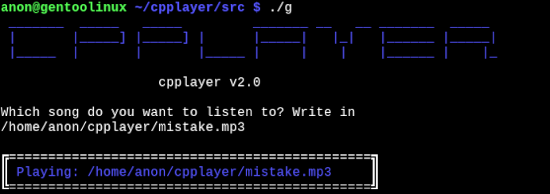

# cpplayer

Minimal CLI audio player (C++ / SFML). Only for Unix-like systems (Linux).



## Requirements

- C++17 compiler
- SFML 3 (`sfml-audio`, `sfml-system`)
- Git

## Install

```sh
git clone https://github.com/Efesint/cpplayer.git
cd cpplayer
make
sudo make install
```

## Usage

```sh
cpplayer
```

Enter the path to an audio file when prompted.

## License

GPL-3.0
